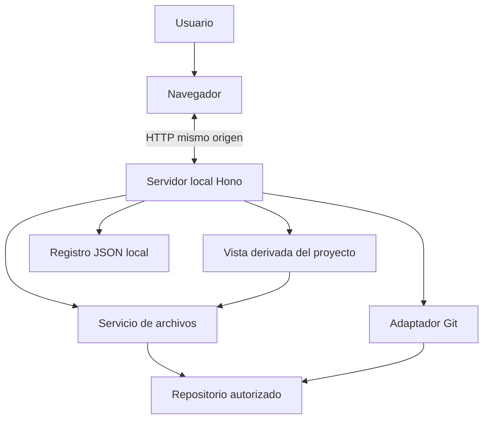

# Visión general de la arquitectura

## Topología

Aplicación web servida localmente por un proceso Node.js. El navegador es la interfaz; el backend local es el único componente que puede acceder al sistema de archivos, Git y persistencia.

## Componentes

- apps/web: SPA React que presenta proyectos, documentación, estado del proyecto y Git.
- apps/api: servidor local Hono sobre Node.js. Valida peticiones, aplica permisos y sirve vistas derivadas de recursos locales.
- packages/contracts: esquemas Zod y tipos compartidos únicamente cuando frontend y backend los necesiten.
- JSON local: persistencia mínima de proyectos registrados y preferencias en el directorio de datos de Workbench, fuera de los repositorios.
- Estado del proyecto: se calcula desde los documentos y Git del repositorio; los archivos permanecen como fuente de verdad.

## Límites y dependencias

- El frontend no accede directamente al sistema de archivos ni ejecuta procesos del sistema.
- El backend es el propietario del acceso a disco y Git.
- Los módulos de dominio no dependen de Hono ni de componentes React.
- Las operaciones Git y de archivos se implementan como servicios separados y con permisos explícitos.
- No se crean microservicios ni servicios cloud en la primera versión.

## Modelo de ejecución

Una instancia local del backend gestiona uno o varios proyectos autorizados. Los agentes y CLI se ejecutan fuera de Workbench; sus cambios se consultan desde el repositorio al refrescar las vistas.

## Seguridad

El backend debe escuchar exclusivamente en loopback. Las rutas de archivos deben permanecer dentro de raíces registradas, incluso después de resolver enlaces simbólicos. La aplicación trata el contenido de repositorios como datos no confiables. Las operaciones mutables requieren aprobación humana.

Consulta backend.md, quality/security-baseline.md y pending-decisions.md.

## Estado de las decisiones

La topología local está aceptada en ADR-0005. Las decisiones de persistencia y seguridad de la V0.1 están detalladas en ADR-0007. La integración de agentes de ADR-0006 queda aplazada fuera del enfoque actual.
