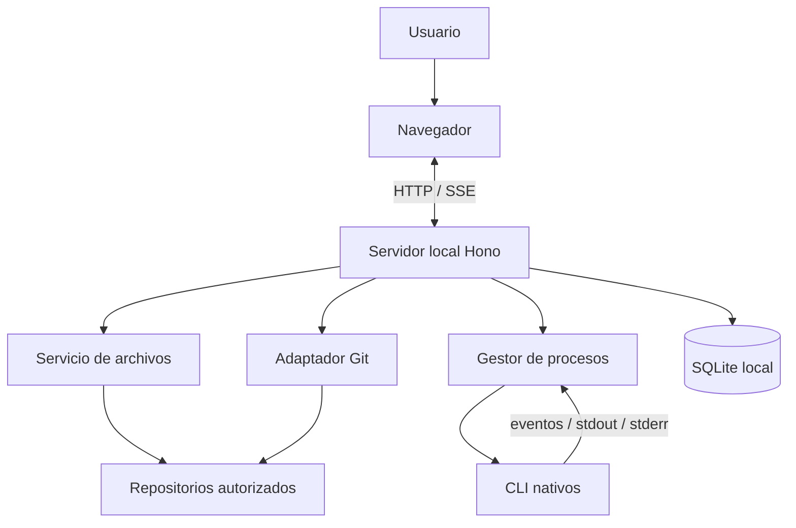

# Visión general de la arquitectura

## Topología

Aplicación web servida localmente por un proceso Node.js. El navegador es la interfaz; el backend local es el único componente que puede acceder al sistema de archivos, Git, procesos CLI y persistencia.

## Componentes

- apps/web: SPA React que presenta proyectos, funcionalidades, agentes y Git.
- apps/api: servidor local Hono sobre Node.js. Valida peticiones, aplica permisos y orquesta servicios locales.
- packages/contracts: esquemas Zod y tipos compartidos únicamente cuando frontend y backend los necesiten.
- SQLite: persistencia local de proyectos registrados, preferencias, sesiones y metadatos del Workbench.
- CLI nativos: procesos independientes, ejecutados con la configuración y autenticación del proveedor.

## Límites y dependencias

- El frontend no accede directamente al sistema de archivos ni ejecuta procesos del sistema.
- El backend es el propietario de la base de datos, del acceso a disco, Git y procesos.
- Los módulos de dominio no dependen de Hono ni de componentes React.
- Los adaptadores de proveedor traducen protocolos específicos a un contrato interno de eventos.
- Las operaciones Git y de archivos se implementan como servicios separados y con permisos explícitos.
- No se crean microservicios ni servicios cloud en la primera versión.

## Modelo de ejecución

Una instancia local del backend gestiona uno o varios proyectos autorizados. Cada sesión de agente se ejecutará con un directorio de trabajo explícito. Cuando dos agentes deban modificar código en paralelo, se utilizarán worktrees distintos; compartir una carpeta de escritura no será el comportamiento predeterminado.

## Seguridad

El backend debe escuchar exclusivamente en loopback. Las rutas de archivos deben permanecer dentro de raíces registradas, incluso después de resolver enlaces simbólicos. Los procesos se ejecutan sin interpolación de shell, con comandos y argumentos validados, límites de salida y cancelación. Las operaciones mutables requieren aprobación humana.

Consulta backend.md, quality/security-baseline.md y pending-decisions.md.

## Estado de las decisiones

La topología local está aceptada en ADR-0005. La selección exacta del driver SQLite, la estrategia de autenticación local y los protocolos definitivos de agentes siguen pendientes de validación técnica.
